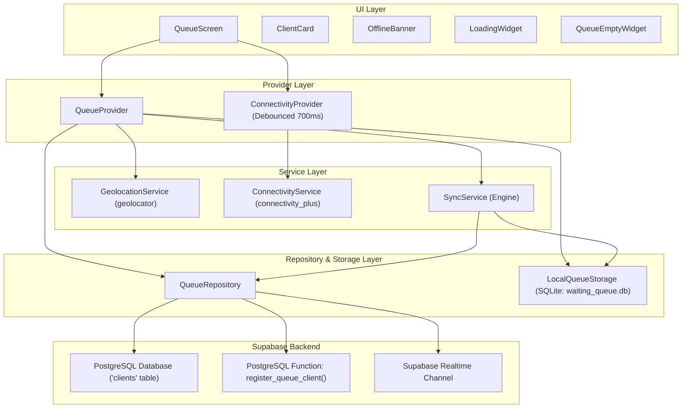

# Technical Documentation: Workshop 6
## Building a Resilient Single-Room Waiting Queue with Flutter & Supabase

**Project**: `waiting_room_app` (TP6)  
**Author**: Iheb Najjar  
**Class**: DSI 31  
**Framework**: Flutter 3.44.8 (Dart SDK ^3.12.2)  
**Target Platforms**: Android, iOS, Web (Chrome / Edge), Windows Desktop  

---

## 1. Project Overview & Architecture

Workshop 6 extends the waiting room system into a resilient, production-grade distributed architecture capable of handling intermittent network connectivity, local offline queuing, device geolocation tagging, automatic server synchronization, and paginated real-time event reconciliation.



### Core Architectural Layers & Responsibilities

| Layer | Component | Responsibility |
| :--- | :--- | :--- |
| **UI** | `QueueScreen`, `ClientCard`, `OfflineBanner`, `LoadingWidget`, `QueueEmptyWidget` | Renders reactive state, user inputs, location metadata badges, and connectivity alerts. |
| **Provider** | `QueueProvider`, `ConnectivityProvider` | Manages app state, debounced backend reachability checks, pagination cursors, and realtime events. |
| **Services** | `GeolocationService`, `ConnectivityService`, `SyncService` | Handles hardware capabilities (GPS), network change streams, ping verification, and offline-to-online batch synchronization. |
| **Repository** | `QueueRepository` | Coordinates authoritative Supabase queries, RPC transactions, pagination (`fetchPage`), and Realtime subscriptions. |
| **Local Storage** | `LocalQueueStorage` | SQLite database (`waiting_queue.db`) persisting clients with sync statuses (`pending`, `syncing`, `synced`, `failed`). |
| **Backend** | Supabase Postgres & Realtime | Authoritative source of queue ordering, numbers, and broadcast notifications. |

---

## 2. Key Business Rules & Implementations

1. **Single Shared Waiting Queue**: All clients join the same queue, irrespective of physical location.
2. **Informational Geolocation**: GPS coordinates are optional context. Denial of location permissions does not block queue registration.
3. **Offline Registrations**: When disconnected, clients are tagged `SyncStatus.pending` in local SQLite. They become official queue entries once synchronized.
4. **Authoritative Server Ordering**: Supabase PostgreSQL timestamps and UUID primary keys determine official order.
5. **Debounced Connectivity**: Network changes are debounced by 700ms, distinguishing between hardware connection (Wi-Fi/Cellular) and actual Supabase backend reachability.
6. **De-duplicated Realtime Reconciliation**: Incoming broadcast events are validated against existing client IDs to prevent duplicates during concurrent pagination and insertions.

---

## 3. Database Schemas & Migrations

### 3.1 Local SQLite Schema (`waiting_queue.db`)

Table: `clients`
```sql
CREATE TABLE clients (
    id TEXT PRIMARY KEY,
    name TEXT NOT NULL,
    lat REAL,
    lng REAL,
    location_accuracy_m REAL,
    created_at TEXT NOT NULL,
    sync_status TEXT NOT NULL
);
```

### 3.2 Remote Supabase PostgreSQL Migration

```sql
-- 1. Extend clients table
ALTER TABLE public.clients
ADD COLUMN IF NOT EXISTS lat DOUBLE PRECISION,
ADD COLUMN IF NOT EXISTS lng DOUBLE PRECISION,
ADD COLUMN IF NOT EXISTS location_accuracy_m DOUBLE PRECISION,
ADD COLUMN IF NOT EXISTS location_captured_at TIMESTAMPTZ;

-- 2. Range validation constraints
ALTER TABLE public.clients
ADD CONSTRAINT valid_latitude CHECK (lat IS NULL OR lat BETWEEN -90 AND 90);

ALTER TABLE public.clients
ADD CONSTRAINT valid_longitude CHECK (lng IS NULL OR lng BETWEEN -180 AND 180);

-- 3. Authoritative Queue Registration Transaction (RPC)
CREATE OR REPLACE FUNCTION register_queue_client(
  p_id UUID,
  p_name TEXT,
  p_lat DOUBLE PRECISION,
  p_lng DOUBLE PRECISION,
  p_accuracy DOUBLE PRECISION,
  p_created_at TIMESTAMPTZ
)
RETURNS SETOF public.clients AS $$
BEGIN
  RETURN QUERY
  INSERT INTO public.clients (
    id, name, lat, lng, location_accuracy_m, created_at
  )
  VALUES (
    p_id, p_name, p_lat, p_lng, p_accuracy, p_created_at
  )
  ON CONFLICT (id) DO UPDATE
  SET name = EXCLUDED.name
  RETURNING *;
END;
$$ LANGUAGE plpgsql SECURITY DEFINER;
```

---

## 4. TDD & Automated Test Suite

A rigorous Test-Driven Development (Red → Green → Refactor) approach was implemented across all layers.

### Test Results Summary:
* **Models**: `test/models/client_test.dart` (5 tests) — Serialization, coordinate formatting, local vs Supabase maps.
* **Services**: 
  - `test/services/geolocation_service_test.dart` (2 tests) — Location permission and error fallbacks.
  - `test/services/sync_service_test.dart` (3 tests) — Status progression (`syncing` → `synced`/`failed`), non-concurrent sync.
* **Providers**: 
  - `test/providers/connectivity_provider_test.dart` (4 tests) — 700ms debounce, offline/online/backendUnavailable transitions.
  - `test/providers/queue_provider_test.dart` (6 tests) — Page loading, pagination de-duplication, realtime inserts and deletions.
* **Widgets**: 
  - `test/widgets/client_card_test.dart` (2 tests) — With/without location badge rendering.
  - `test/widgets/offline_banner_test.dart` (4 tests) — Dynamic banner color and text per connectivity state.

**Total**: **26 tests passing, 0 failures, 100% pass rate.**
**Static Analysis**: `flutter analyze` completed with **0 issues found**.

---

## 5. Git Collaboration & Branch Workflow

Following professional engineering standards, features were developed on isolated Git branches and integrated into `main` using non-fast-forward merge commits:

1. `main` (Initial project boilerplate & configuration)
2. `feature/geolocation` → Merged into `main` (`937c893`)
3. `feature/connectivity` → Merged into `main` (`b58078c`)
4. `feature/offline-sync` → Merged into `main` (`206448e`)
5. `feature/pagination-realtime` → Merged into `main` (`22f078b`)
